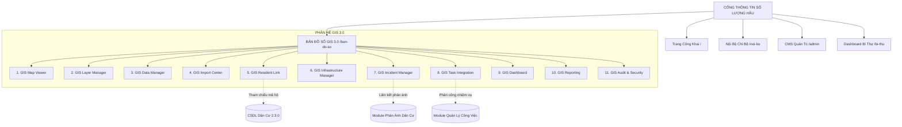

# KIẾN TRÚC HỆ THỐNG PHÂN HỆ BẢN ĐỒ SỐ LƯƠNG HẬU – DIGITAL GIS 3.0
**Dự án:** Cổng thông tin điện tử Tổ dân phố Lương Hậu  
**Website:** https://luong-hau.vercel.app  
**Đơn vị:** Tổ dân phố Lương Hậu, phường Hương Thủy, thành phố Huế  
**Tiêu chuẩn:** Clean Architecture & Additive Integration  

---

## 1. TỔNG QUAN KIẾN TRÚC PHÂN TẦNG

Hệ thống được thiết kế theo mô hình tích hợp không xâm lấn (Non-intrusive / Additive Architecture), bảo tồn nguyên vẹn các luồng nghiệp vụ hiện tại:

---

## 2. CHI TIẾT CÁC PHÂN HỆ THÀNH PHẦN

### 2.1. GIS Map Viewer (Bộ hiển thị bản đồ số)
* **Vị trí tích hợp:** `bando.html` (Rewrite: `/ban-do-so`, `/gis`, `/ban-do`, `/bando`).
* **Động cơ bản đồ:** Leaflet v1.9.4.
* **Bản đồ nền (Base Maps):**
  1. *Ảnh vệ tinh Esri World Imagery (High-Resolution Satellite).*
  2. *Bản đồ đường phố OpenStreetMap (OSM Standard).*
  3. *Bản đồ sơ đồ quy hoạch TDP Lương Hậu dạng SVG Vector Schematic.*
  4. *Tích hợp trực tiếp Google Earth 3D* qua khung xem modal và liên kết mở rộng tới dự án thực địa Lương Hậu.
* **Công cụ đo đạc không gian (Spatial Measurement Tools):**
  * Đo khoảng cách giữa các điểm trên tuyến đường (Distance Tool - Geodesic Turf.js).
  * Đo diện tích các thửa đất, công trình hoặc khu vực ngập lụt (Area Tool - Spherical Polygon Turf.js).
* **Trải nghiệm tìm kiếm tối ưu diện tích (Responsive Collapsible Search):**
  * Thay thế thanh tìm kiếm cố định chiếm không gian bằng nút bấm tròn nổi bật kèm biểu tượng kính lúp.
  * Khi bấm, mở thanh tìm kiếm trượt nhẹ nhàng (drawer/popup), cho phép tìm theo mã hộ, tên đường, loại công trình hoặc tình trạng ngập lụt.

### 2.2. GIS Layer Manager (Quản lý lớp chuyên đề)
Quản lý bật/tắt linh hoạt 9 lớp thông tin không gian:
1. **Lớp Ranh giới (Boundary Layer):** Ranh giới hành chính TDP Lương Hậu (đa giác màu vàng viền nét đứt/liền) kèm diện tích và chu vi.
2. **Lớp Tuyến đường (Roads Layer):** Tuyến đường chính (Trần Hoàn, Thái Thuận...), ngõ kiệt, hiện trạng mặt đường (bê tông, nhựa), hệ thống thoát nước và chiếu sáng.
3. **Lớp Hộ dân (Households Layer):** 466 điểm tọa độ hộ dân, hỗ trợ phân cụm marker (MarkerCluster) khi thu nhỏ.
4. **Lớp Hạ tầng (Infrastructure Layer):** Cột đèn chiếu sáng, trạm biến áp, cống thoát nước, họng cứu hỏa, điểm tập kết rác.
5. **Lớp Công trình công cộng (Landmarks Layer):** Nhà sinh hoạt cộng đồng 83 Thái Thuận, Đình làng Lương Hậu, di tích văn hóa.
6. **Lớp Phản ánh hiện trường (Incidents Layer):** Các điểm sự cố phản ánh (đèn hỏng, tắc cống, ô nhiễm).
7. **Lớp Công việc hiện trường (Tasks Layer):** Nhiệm vụ cán bộ được phân công xử lý theo vị trí địa lý.
8. **Lớp Môi trường & Ngập lụt (Flood & Environment Layer):** Vùng cảnh báo nguy cơ ngập lụt khi mưa lớn.
9. **Lớp An ninh trật tự (Security Layer - Nội bộ):** Khu vực tuần tra, camera an ninh, điểm cần lưu ý (chỉ dành cho tài khoản có quyền).

### 2.3. GIS Data Manager & CMS Integration (Quản trị dữ liệu)
* Tích hợp trực tiếp vào `admin.html` qua thẻ tab `#tab-gis-data`.
* Cung cấp bảng quản trị danh sách đối tượng không gian: Thêm mới, chỉnh sửa tọa độ, cập nhật thuộc tính, xóa mềm (soft delete), phục hồi (restore).
* Kiểm soát quy trình duyệt 2 bước: `DRAFT / PENDING` → `APPROVED` → `PUBLISHED`.

### 2.4. GIS Import Center (Trung tâm nhập dữ liệu GPS/GIS)
* Hỗ trợ các định dạng tiêu chuẩn: **GeoJSON (.geojson, .json)**, **KML/KMZ (.kml, .kmz)**, **GPX (.gpx)**, **Shapefile (.zip chứa .shp, .shx, .dbf, .prj)**, **CSV tọa độ**, **Excel XLSX**.
* Bộ xử lý tiền kiểm tra (Pre-validation Pipeline):
  * Kiểm tra dung lượng (< 10MB), phần mở rộng, cú pháp mã hóa UTF-8.
  * Nhận diện và chuyển đổi hệ tọa độ: Mặc định chuẩn WGS84 (EPSG:4326), cảnh báo nếu dữ liệu thuộc hệ VN-2000 để người dùng xác nhận tham số kinh tuyến trục trước khi chiếu.
  * Kiểm tra phạm vi tọa độ Lương Hậu (Latitude: 16.40° - 16.46° N, Longitude: 107.67° - 107.73° E).
  * Xem trước đối tượng trên bản đồ nhỏ trước khi lưu vào vùng tạm (Staging).
  * Hỗ trợ tính năng hoàn tác theo lô nhập (Batch Rollback).

### 2.5. GIS Resident Link (Liên kết dân cư bảo vệ dữ liệu cá nhân)
* Liên kết 1-1 giữa đối tượng `gis_features` (loại `HOUSEHOLD`) và hồ sơ trong CSDL Dân cư 2.3.0 qua khóa `household_reference_id = household.ma_ho`.
* **Tuyệt đối tuân thủ bảo vệ dữ liệu cá nhân:**
  * Trên giao diện công khai: Chỉ hiển thị Mã Hộ (ví dụ: `LH-001`) và Tuyến Đường. Không hiển thị Họ tên chủ hộ, không hiển thị số CCCD/Định danh cá nhân, không hiển thị số điện thoại, không hiển thị diện chính sách.
  * Chỉ khi người dùng đăng nhập với vai trò `ADMIN`, `BI_THU` hoặc `TO_TRUONG`, hệ thống mới giải mã và hiển thị chi tiết nhân thân qua Drawer bảo mật.

### 2.6. GIS Infrastructure Manager (Quản lý hạ tầng)
* Quản lý vòng đời tài sản công ích: Mã tài sản, loại (đèn đường, cống ngầm, nắp hố ga, thùng rác), hiện trạng sử dụng (Bình thường, Cần bảo trì, Hư hỏng nặng), lịch sử kiểm tra định kỳ, đơn vị chịu trách nhiệm.

### 2.7. GIS Incident Manager (Quản lý phản ánh hiện trường)
* Kết nối phân hệ phản ánh dân cư hiện có (`phan-anh/`).
* Khi tiếp nhận phản ánh có tọa độ hoặc địa chỉ tuyến đường, tạo đối tượng đánh dấu trên bản đồ nội bộ.
* Quy trình: Người dân gửi phản ánh → Ban điều hành xác minh vị trí → Phân công cán bộ hiện trường → Cập nhật ảnh xử lý → Đóng phản ánh.

### 2.8. GIS Dashboard & Reporting (Báo cáo & Giám sát)
* Tích hợp widget bản đồ mini và các chỉ số đo lường:
  * Tổng số tuyến đường & chiều dài đường bê tông/nhựa.
  * Tỷ lệ hộ dân đã có tọa độ GPS chính xác (hiện đạt 466/466 hộ = 100%).
  * Số lượng tài sản hạ tầng đang vận hành tốt / cần sửa chữa.
  * Tình hình phản ánh hiện trường đang xử lý.
* Xuất báo cáo chuyên nghiệp: GeoJSON xuất theo quyền, CSV danh mục tài sản, in ấn bản đồ đồ họa.

---

## 3. THIẾT KẾ GIAO DIỆN & TRẢI NGHIỆM NGƯỜI DÙNG (UI/UX)

1. **Header Bar:**
   * Tiêu đề: *BẢN ĐỒ SỐ TỔ DÂN PHỐ LƯƠNG HẬU – GIS 3.0*.
   * Nút Tìm kiếm mở rộng (Collapsible Search Toggle).
   * Lựa chọn bản đồ nền (Vệ tinh / Bản đồ số / Sơ đồ quy hoạch).
   * Nút Công cụ đo đạc (Thước đo / Diện tích).
   * Nút Mở rộng toàn màn hình (Fullscreen) & In bản đồ.
   * Cổng xem Google Earth 3D Lương Hậu.
2. **Left Control Bar (Quản lý lớp):**
   * Accordion nhóm lớp thông tin có checkbox bật/tắt độc lập kèm biểu tượng trực quan.
   * Bộ lọc nhanh theo mức độ ngập lụt, theo khu vực tổ liên gia, theo loại tài sản.
3. **Map Canvas (Vùng trung tâm tương tác):**
   * Ranh giới TDP viền màu vàng nổi bật, rõ ràng.
   * Điểm đánh dấu hộ gia đình có màu sắc phân loại thông minh (Hộ chính sách: Tím; Ngập lụt: Đỏ; An toàn: Xanh dương; Công trình: Đỏ cờ sao vàng).
   * Hỗ trợ tương tác mượt mà trên chuột máy tính và cử chỉ chạm cảm ứng trên smartphone/tablet.
4. **Detail Drawer / Popup (Bảng thông tin chi tiết):**
   * Thẻ Card UI bo góc hiện đại, phân quyền hiển thị thông tin rõ ràng.
   * Nút điều hướng chỉ đường qua Google Maps Navigation (`https://www.google.com/maps/dir/?api=1&destination=lat,lng`).

---

## 4. BẢO MẬT & KIỂM SOÁT PHÂN QUYỀN
* Áp dụng nguyên tắc Principle of Least Privilege (Đặc quyền tối thiểu).
* Dữ liệu nhạy cảm được bảo vệ nghiêm ngặt: Mã hóa local cache, không lưu CCCD trên URL hay LocalStorage công khai.
* Ghi nhật ký đầy đủ (Audit Log) cho mọi hành động thêm, sửa tọa độ, nhập file, phê duyệt hoặc xóa đối tượng GIS.
