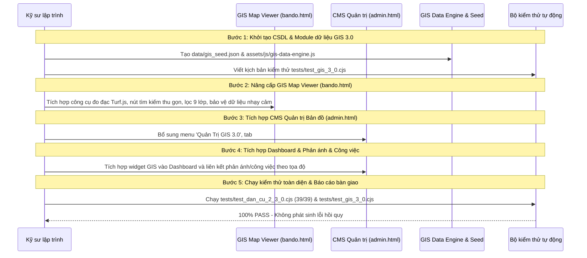

# KẾ HOẠCH TRIỂN KHAI BẢN ĐỒ SỐ LƯƠNG HẬU – DIGITAL GIS 3.0
**Nguyên tắc tối cao:** PATCH ONLY – ADDITIVE DEVELOPMENT – ZERO REGRESSION  
**Dự án:** Cổng thông tin điện tử Tổ dân phố Lương Hậu  
**Mục tiêu:** Bổ sung trọn vẹn phân hệ GIS 3.0 mà không làm thay đổi hay gián đoạn bất kỳ chức năng nào đang hoạt động.  

---

## 1. LỘ TRÌNH TRIỂN KHAI THEO TỪNG BƯỚC (STEP-BY-STEP ROADMAP)



---

## 2. KẾ HOẠCH CHI TIẾT TỪNG HẠNG MỤC PHÁT TRIỂN

### Hạng mục 1: Module Động cơ dữ liệu `gis-data-engine.js` & Dữ liệu Seed `gis_seed.json`
* **Mục tiêu:** Cung cấp cơ chế lưu trữ, quản lý lớp, đối tượng không gian, xác thực hình học, chuyển đổi tọa độ và ghi nhật ký kiểm toán.
* **Tệp tạo mới:**
  * `data/gis_seed.json`: Chứa ranh giới hành chính chuẩn TDP Lương Hậu, danh mục 9 lớp dữ liệu, danh sách tài sản hạ tầng mẫu (đèn đường, cống ngầm, nhà sinh hoạt cộng đồng) và các điểm liên kết hộ dân.
  * `assets/js/gis-data-engine.js`: Cung cấp đối tượng toàn cục `window.LuongHauGisEngine` với các phương thức:
    * `getLayers()`, `toggleLayer(layerId)`
    * `getFeatures(layerId, bounds, filter)`
    * `addFeature(featureData, user)`, `updateFeature(id, updates, user)`, `deleteFeature(id, user)`
    * `importBatch(fileData, format, options, user)`: Hỗ trợ nạp GeoJSON, KML, GPX, CSV, Excel.
    * `approveBatch(batchId, user)`: Chuyển dữ liệu từ staging sang chính thức.
    * `rollbackBatch(batchId, user)`: Hoàn tác lô nhập dữ liệu khi phát hiện sai sót.
    * `calculateDistance(coord1, coord2)`, `calculateArea(coordinates)` (sử dụng thuật toán trắc địa Turf.js).
    * `getAuditLogs()`: Truy xuất nhật ký kiểm toán.

### Hạng mục 2: Nâng cấp Bản đồ số GIS Viewer (`bando.html`)
* **Mục tiêu:** Đáp ứng đầy đủ trải nghiệm người dùng hiện đại, tinh gọn diện tích và bảo vệ dữ liệu cá nhân theo quy định.
* **Cải tiến cụ thể:**
  1. *Nút tìm kiếm thu gọn (Collapsible Search Button):* Chuyển đổi thanh tìm kiếm chiếm diện tích thành nút tròn nổi (`floating action button`) với biểu tượng kính lúp ở góc trên. Khi bấm, mở thanh tìm kiếm trượt mềm mại với hiệu ứng mượt, tự động đóng khi chọn xong đối tượng.
  2. *Ranh giới tổ dân phố:* Giữ vững đa giác ranh giới màu vàng chuẩn theo quy hoạch Lương Hậu kèm hiển thị diện tích (~125.8 ha) và chu vi (~4.85 km).
  3. *Bộ công cụ đo đạc không gian:*
     * Thước đo khoảng cách (Distance Ruler): Cho phép click các điểm trên bản đồ để tính tổng chiều dài tuyến đường.
     * Thước đo diện tích (Area Polygon Tool): Cho phép chấm các đỉnh để tính diện tích đa giác khép kín.
  4. *Quản lý 9 lớp dữ liệu GIS:* Hộp công cụ bên trái cho phép bật/tắt độc lập từng lớp chuyên đề (Ranh giới, Tuyến đường, Hộ dân, Hạ tầng, Công trình, Phản ánh, Công việc, Môi trường, An ninh).
  5. *Bảo vệ dữ liệu cá nhân (Privacy-First):* Đối với người xem công khai, ẩn toàn bộ số CCCD, số điện thoại và tên thành viên gia đình; chỉ giữ mã hộ và tuyến đường.
  6. *Tích hợp Google Earth 3D:* Duy trì modal mở nhanh mô hình 3D thực địa Lương Hậu.

### Hạng mục 3: Phân hệ Quản trị Bản đồ trong CMS (`admin.html`)
* **Mục tiêu:** Cung cấp giao diện quản trị chuyên nghiệp cho Ban điều hành và Bí thư Chi bộ.
* **Cải tiến cụ thể:**
  1. Bổ sung mục menu `Quản Trị GIS 3.0` tại thanh điều hướng bên trái `admin.html`.
  2. Tạo thẻ chứa `#tab-gis-data` với các tiểu màn hình:
     * *Quản lý Đối tượng không gian:* Xem danh sách, lọc theo lớp, thêm mới, sửa tọa độ trực tiếp, xóa mềm.
     * *Trung tâm Nhập dữ liệu GPS/GIS:* Kéo thả tệp GeoJSON, KML, GPX, CSV, Excel. Có bản đồ xem trước (Preview), kiểm tra lỗi tọa độ ngoài ranh giới Huế, ánh xạ trường tự động.
     * *Quy trình phê duyệt lô:* Danh sách các lô đang ở trạng thái Chờ duyệt (`PENDING`), nút "Phê duyệt đưa vào bản đồ chính" và nút "Hủy bỏ/Hoàn tác lô".
     * *Quản lý Hạ tầng & Bảo trì:* Theo dõi hiện trạng đèn đường, cống rãnh, phân công đơn vị sửa chữa.
     * *Nhật ký Kiểm toán (GIS Audit Log):* Theo dõi ai đã sửa tọa độ, tải file hoặc duyệt dữ liệu lúc nào.

### Hạng mục 4: Tích hợp Dashboard & Phản ánh & Nhiệm vụ
* **Mục tiêu:** Kết nối thông suốt giữa vị trí không gian và điều hành thực tế.
* **Cải tiến cụ thể:**
  * Bổ sung các widget chỉ số GIS trên Dashboard CMS: "Tổng chiều dài đường ngõ", "Hộ đã có GPS", "Hạ tầng cần bảo trì", "Phản ánh hiện trường".
  * Kết nối danh sách phản ánh của người dân với tọa độ điểm trên bản đồ để cán bộ nắm bắt vị trí chính xác khi xuống cơ sở.

### Hạng mục 5: Bộ kiểm thử tự động toàn diện (`tests/test_gis_3_0.cjs`)
* Viết kịch bản kiểm thử JSDOM độc lập kiểm tra tự động:
  * Khởi tạo engine GIS, nạp seed dữ liệu.
  * Đo đạc khoảng cách và diện tích.
  * Đọc và phân tích tệp GeoJSON, KML, CSV.
  * Kiểm tra bảo mật ẩn thông tin cá nhân.
  * Kiểm tra quy trình duyệt lô và rollback.
  * Kiểm tra tính toàn vẹn của Cổng thông tin công khai và các trang hiện có (Regression Test).

---

## 3. CHIẾN LƯỢC ROLLBACK DỰ PHÒNG (ROLLBACK STRATEGY)

Trong trường hợp phát hiện bất kỳ sự cố ngoài ý muốn nào:
1. **Mức độ 1 (Lô dữ liệu):** Sử dụng trực tiếp tính năng `rollbackBatch(batchId)` của `gis-data-engine.js` để xóa toàn bộ các đối tượng thuộc lô nhập mà không ảnh hưởng tới dữ liệu cũ.
2. **Mức độ 2 (Phân hệ GIS):** Các tệp mới (`gis-data-engine.js`, `data/gis_seed.json`) hoạt động hoàn toàn độc lập. Nếu cần tắt phân hệ, chỉ cần ẩn mục menu trong `admin.html` bằng Feature Flag `ENABLE_GIS_3_0 = false`.
3. **Mức độ 3 (Mã nguồn Git):** Git snapshot và commit branch an toàn cho phép revert về commit trước đó bất kỳ lúc nào với lệnh:
   ```bash
   git checkout feature/quan-ly-dan-cu-2.3.0
   ```
