# KIẾN TRÚC PHÂN HỆ QUẢN LÝ DÂN CƯ SỐ LƯƠNG HẬU – VERSION 2.3.0
**Đơn vị sử dụng:** Tổ dân phố Lương Hậu, phường Hương Thủy, TP. Huế  
**Phiên bản:** 2.3.0 (SAFE PATCH ONLY - 100% PRODUCTION READY)  
**Ngày phát hành:** 24/10/2026  

---

## 1. TỔNG QUAN HỆ THỐNG VÀ NGUYÊN TẮC THIẾT KẾ

Phân hệ **Quản Lý Dân Cư Số Lương Hậu v2.3.0** được phát triển và tích hợp theo nguyên tắc **SAFE PATCH ONLY**:
- **Bảo toàn 100% hệ thống hiện có:** Không làm thay đổi giao diện trang chủ công khai (`index.html`), cờ Đảng, cờ Tổ quốc, màu sắc, font chữ, các chuyên mục tin tức, văn bản, thông báo, bản đồ số GIS (`bando.html`) hay luồng đăng nhập nội bộ.
- **Cô lập dữ liệu dân cư:** Tuyệt đối không để lộ dữ liệu dân cư, CCCD, số điện thoại, tình trạng BHYT ra ngoài Internet hay trong giao diện công khai của người dân. Phân hệ được đặt trọn vẹn trong khu vực Quản trị / Điều hành nội bộ (`admin.html`), yêu cầu xác thực phiên và phân quyền RBAC đa cấp.
- **Hệ thống dữ liệu phân tầng:** Kết hợp lưu trữ cấu trúc tại Client (IndexedDB / LocalStorage có mã hóa) làm việc với dữ liệu hạt nhân `dan_cu_seed.json` (466 hộ, 1.943 nhân khẩu thực tế), hỗ trợ đồng bộ thời gian thực từ Google Sheets qua kết nối CORS an toàn hoặc nhập thủ công tệp XLSX/CSV.

---

## 2. SƠ ĐỒ KIẾN TRÚC TỔNG THỂ (MERMAID)

```mermaid
graph TD
    subgraph Public_Zone [VÙNG CÔNG KHAI - BẢO MẬT TUYỆT ĐỐI]
        PortalHome[Trang Chủ TDP Lương Hậu / index.html]
        GISPublic[Bản Đồ Số Cộng Đồng / bando.html]
        NewsDocs[Tin tức - Thông báo - Văn bản]
    end

    subgraph Internal_Zone [VÙNG ĐIỀU HÀNH NỘI BỘ - ADMIN.HTML]
        AuthGate[Xác Thực Phiên & Kiểm Soát Vai Trò RBAC]
        LegacyCMS[CMS 5 Phân Hệ Hiện Hữu]
        BiThuHub[Điều Hành Bí Thư / bi-thu.html]
        
        subgraph DanCu_Subsystem [PHÂN HỆ DÂN CƯ SỐ 2.3.0]
            Router[Bộ Điều Hướng 16 Tiểu Phân Hệ]
            StateMgr[Quản Lý Trạng Thái & Bộ Đệm Bộ Nhớ]
            MaskingEngine[Động Cơ Che Dữ Liệu CCCD/SĐT Tự Động]
            
            subgraph Features [16 Chức Năng Nghiệp Vụ]
                F1[1. Tổng Quan Dashboard]
                F2[2. Quản Lý Hộ Gia Đình]
                F3[3. Quản Lý Nhân Khẩu]
                F4[4. Quản Lý BHYT]
                F5[5. Nhập Excel/CSV Thông Minh]
                F6[6. Đồng Bộ Google Sheets]
                F7[7. Tiếp Nhận Văn Bản Zalo]
                F8[8. OCR Cục Bộ Canvas]
                F9[9. Địa Chỉ Số & Tọa Độ GPS]
                F10[10. Tìm Kiếm Nâng Cao]
                F11[11. Trường Mở Rộng]
                F12[12. Xuất Báo Cáo Excel/PDF]
                F13[13. Sao Lưu & Phục Hồi]
                F14[14. Phân Quyền RBAC]
                F15[15. Nhật Ký Hoạt Động]
                F16[16. Cấu Hình Phân Hệ]
            end
        end
    end

    subgraph Data_Storage [TẦNG LƯU TRỮ VÀ DỮ LIỆU NGUỒN]
        SeedData[(Seed DB: 466 Hộ, 1.943 Nhân Khẩu)]
        BrowserDB[(CSDL LuongHauDatabase / LocalStorage / IndexedDB)]
        GSheets[Google Sheets Nguồn: TDP Lương Hậu]
        BackupEnc[(Tệp Sao Lưu JSON Mã Hóa Base64 + SHA256)]
    end

    AuthGate --> Router
    Router --> StateMgr
    StateMgr <--> BrowserDB
    BrowserDB -.Khởi tạo tự động ban đầu.-> SeedData
    GSheets --Đọc một chiều / Kiểm tra / Xác nhận--> F6
    F6 --> StateMgr
    F13 <--> BackupEnc
```

---

## 3. CÁC THÀNH PHẦN VÀ CẤU TRÚC TỆP TIN

### 3.1. Các Tệp Tin Mới (New Components)
1. `assets/css/quan-ly-dan-cu.css`: Hệ thống giao diện hiện đại, kế thừa tông màu Cổng thông tin (Đỏ đô `#990000`, Vàng hoàng gia `#D4AF37`, Xanh navy `#0B2545`), hỗ trợ Dark/Light mode, thẻ chỉ số thống kê, bảng phân trang, diff preview, responsive 100% trên Android/iOS và desktop.
2. `assets/js/quan-ly-dan-cu.js`: Lõi phân hệ điều khiển toàn bộ 16 chức năng (`window.QuanLyDanCu`), kiểm soát phân quyền, render UI, xử lý import/export, bóc tách Zalo/OCR và đồng bộ Google Sheets.
3. `assets/js/dan-cu-seed.js`: Dữ liệu cơ sở 466 hộ, 1.943 nhân khẩu gắn vào `window.DAN_CU_SEED_DATA`.
4. `data/dan_cu_seed.json`: File dữ liệu hạt nhân JSON tiêu chuẩn dùng trong kiểm thử và build pipeline.
5. `tests/test_dan_cu_2_3_0.cjs`: Bộ kiểm thử tự động toàn diện (39 bài test, bao phủ 16 tiểu phân hệ và bảo mật).

### 3.2. Điểm Tích Hợp Vào Hệ Thống Cũ (Integration Touchpoints)
- `admin.html`: Bổ sung menu `Quản Lý Dân Cư (v2.3.0)`, khung thẻ `
`, kích hoạt tự động `window.QuanLyDanCu.mount()` khi chọn menu.
- `bi-thu.html`: Bổ sung liên kết điều hướng nhanh `Quản Lý Dân Cư Số ↗` tại danh mục công cụ lãnh đạo.
- `noi-bo.html` & `src/pages/noi_bo.astro`: Bổ sung shortcut liên kết quản lý dân cư số.
- `astro/sync-public.mjs`: Tích hợp các tệp tĩnh mới vào luồng build tĩnh của Astro.

---

## 4. LUỒNG XỬ LÝ DỮ LIỆU ĐẶC THÙ

### 4.1. Không Ghi Ngược (One-way Data Flow)
Hệ thống kết nối Google Sheets với quyền **READ-ONLY tuyệt đối**:
- Không gửi bất kỳ token ghi nào lên Google API.
- Dữ liệu tải từ Google Sheets phải đi qua 3 bước:
  1. **Tải & Phân tích cấu trúc (Preview):** Hiển thị danh sách các hộ/nhân khẩu phát hiện mới, thay đổi hoặc nghi trùng.
  2. **Báo cáo sai khác (Diff Report):** Cán bộ xem xét từng dòng, số lượng hợp lệ, lỗi hoặc xung đột.
  3. **Phê duyệt ghi (Admin Approval):** Chỉ ghi vào CSDL khi người có thẩm quyền nhấn "Xác nhận cập nhật".

### 4.2. Chống Tấn Công Injection & Rò Rỉ Dữ Liệu
- **CSV/Excel Formula Injection:** Toàn bộ dữ liệu nhập xuất đều được lọc tự động. Bất kỳ ô dữ liệu nào bắt đầu bằng dấu `=`, `+`, `-`, `@` đều được thêm dấu nháy đơn `'` ở đầu trước khi kết xuất hoặc lưu.
- **Role-based Data Masking:** Dữ liệu số CCCD (12 số) và Số điện thoại (10 số) tự động che 6 ký tự giữa đối với các vai trò không có thẩm quyền cao nhất (`ADMIN` và `BI_THU`).
