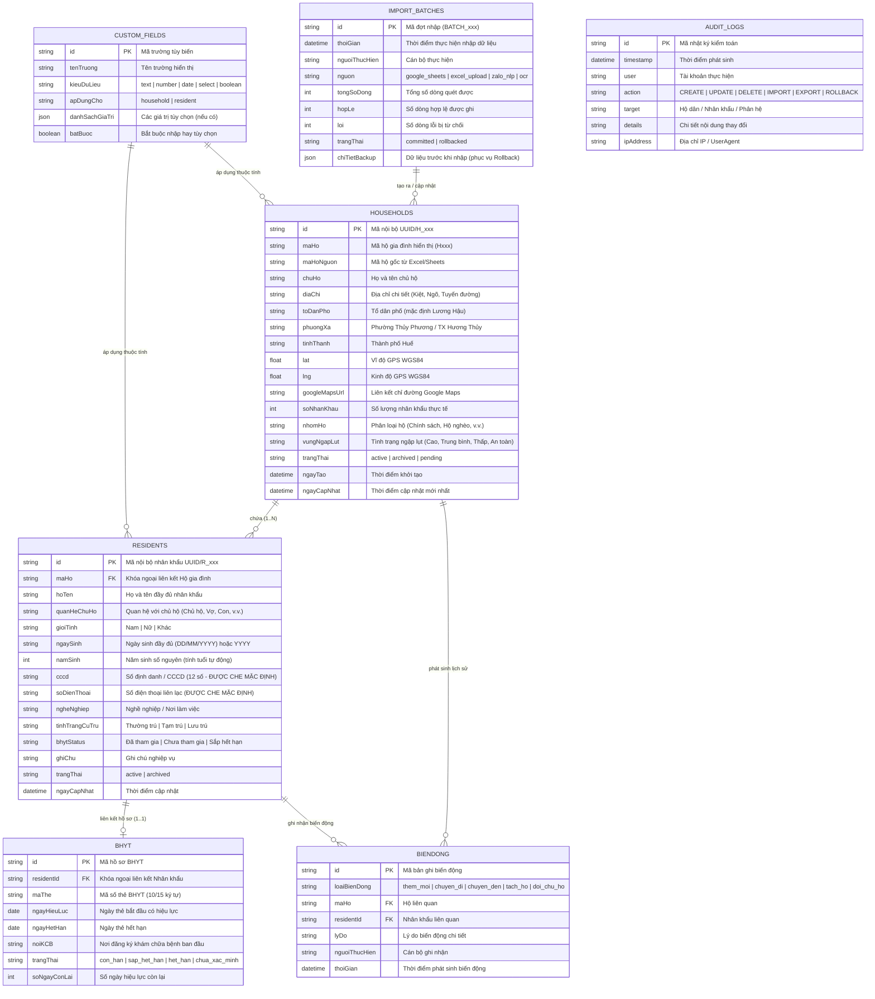

# THIẾT KẾ CƠ SỞ DỮ LIỆU – PHÂN HỆ QUẢN LÝ DÂN CƯ SỐ 2.3.0
**Đơn vị sử dụng:** Tổ dân phố Lương Hậu, phường Hương Thủy, TP. Huế  
**Phiên bản CSDL:** v2.3.0  
**Cơ chế lưu trữ:** LocalStorage / IndexedDB / JSON Seed Sync  

---

## 1. MÔ HÌNH THỰC THỂ QUAN HỆ (ERD)

---

## 2. QUY TẮC TOÀN VẸN VÀ RÀNG BUỘC NGHIỆP VỤ (BUSINESS CONSTRAINTS)

1. **Khóa chính và Khóa ngoại:**
   - Không sử dụng Số CCCD hay Họ tên chủ hộ làm khóa chính vì có thể trùng lặp họ tên hoặc chưa có số CCCD.
   - Mỗi hộ gia đình có duy nhất một `maHo` và một `chuHo`.
   - Một nhân khẩu chỉ được liên kết với một `maHo` hoạt động (`active`) tại một thời điểm.

2. **Quy tắc Lưu trữ Ngày sinh & Tính Tuổi:**
   - Trường `namSinh` được lưu trữ độc lập dạng số nguyên để hệ thống tự động tính tuổi thực tế theo thời gian thực: `Tuổi = Năm hiện tại - namSinh`.
   - Trường `ngaySinh` hỗ trợ định dạng đầy đủ `DD/MM/YYYY` hoặc chỉ ghi nhận `YYYY` khi người cao tuổi không rõ ngày tháng sinh (tuyệt đối không tự gán ngày 01/01 làm ngày sinh thật nếu công dân không khai báo).

3. **Cơ chế Soft Delete (Lưu trữ thay vì xóa cứng):**
   - Không cho phép thao tác xóa cứng (`DELETE`) trực tiếp đối với bản ghi Hộ dân hoặc Nhân khẩu đang có dữ liệu lịch sử.
   - Sử dụng cờ trạng thái `trangThai = 'archived'` để đánh dấu chuyển đi, chuyển khẩu hoặc lưu trữ hồ sơ, đảm bảo toàn vẹn dữ liệu thống kê qua các năm.

4. **Bảo mật và Che dấu dữ liệu (Data Masking):**
   - Trường `cccd` và `soDienThoai` được hệ thống tự động che khi trả về cho các vai trò không phải Quản trị viên tối cao hoặc Bí thư chi bộ.
   - Công thức che: `046******123` (giữ 3 số đầu, 3 số cuối, che 6 số giữa bằng `*`).

---

## 3. DỮ LIỆU CƠ SỞ ĐÃ NẠP (BASELINE DATA)
- **Tổng số hộ gia đình:** 466 hộ
- **Tổng số nhân khẩu:** 1.943 nhân khẩu
- **Hộ gia đình có nguy cơ ngập lụt:** 25 hộ
- **Hộ gia đình thuộc diện chính sách:** 12 hộ
- **Tập dữ liệu nguồn đối chiếu:** Bảng tính Google Sheets Tổ dân phố Lương Hậu (`1DgXp5p3If8xe8ZNCi1HTyQcgZ4HtfIao7aM0Kf_zvyQ`).
