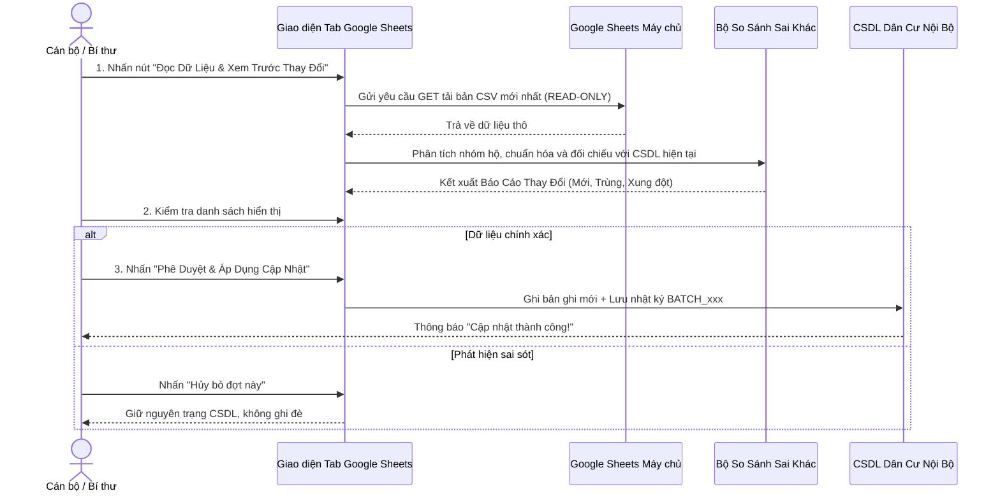

# HƯỚNG DẪN ĐỒNG BỘ DỮ LIỆU GOOGLE SHEETS KHÔNG DÙNG CODE
**Phân hệ:** Quản Lý Dân Cư Số Lương Hậu 2.3.0  
**Đối tượng:** Ban cán sự TDP Lương Hậu, Bí thư Chi bộ, Cán bộ phụ trách  
**Mục tiêu:** Cung cấp phương thức cập nhật dữ liệu dân cư từ Google Sheets một cách an toàn, dễ hiểu, trực quan, không đòi hỏi kiến thức lập trình.

---

## 1. THÔNG TIN NGUỒN DỮ LIỆU THAM CHIẾU

- **Địa chỉ bảng tính chính thức:**  
  `https://docs.google.com/spreadsheets/d/1DgXp5p3If8xe8ZNCi1HTyQcgZ4HtfIao7aM0Kf_zvyQ/edit?usp=drivesdk`
- **Tên bảng tính:** Sổ theo dõi dân cư Tổ dân phố Lương Hậu (phường Thủy Phương / TX Hương Thủy, TP. Huế).
- **Cấu trúc cột dữ liệu chuẩn:**
  1. `STT`: Số thứ tự
  2. `Chủ hộ`: Họ và tên chủ hộ gia đình
  3. `Họ và tên`: Họ và tên thành viên nhân khẩu
  4. `Ngày sinh`: Ngày tháng năm sinh hoặc năm sinh
  5. `Giới tính`: Nam / Nữ
  6. `Số CCCD`: Số định danh cá nhân 12 chữ số
  7. `Số điện thoại`: Số điện thoại liên lạc
  8. `HKTT`: Hộ khẩu thường trú / Địa chỉ cư trú
  9. `chính sách, khó khăn`: Phân loại đối tượng chính sách
  10. `Hộ bị ngập lụt`: Mức độ ngập lụt khi mưa lũ
  11. `Tuyến đường`: Tên đường, kiệt, ngõ nội bộ
- **Trạng thái kết nối thực tế:**
  - Endpoint xuất dữ liệu CSV trực tiếp: `https://docs.google.com/spreadsheets/d/1DgXp5p3If8xe8ZNCi1HTyQcgZ4HtfIao7aM0Kf_zvyQ/export?format=csv`
  - Đã kiểm tra kết nối mạng thực tế: **Phản hồi 200 OK với đầy đủ tiêu đề CORS (`Access-Control-Allow-Origin: *`)**, cho phép trình duyệt của cán bộ đọc dữ liệu trực tiếp mà không cần cài đặt phần mềm trung gian.

---

## 2. QUY TRÌNH 1: CẬP NHẬT TRỰC TIẾP TRÊN GIAO DIỆN (1 CÚ NHẤP CHUỘT)

Phương pháp này được thiết kế hoàn toàn trực quan:

### Các bước thực hiện cụ thể:
1. Đăng nhập vào trang quản trị `admin.html` -> Chọn mục **"Quản Lý Dân Cư (v2.3.0)"**.
2. Chuyển sang thẻ tab số **"6. Google Sheets"**.
3. Tại ô **"Đường dẫn bảng tính Google Sheets"**, hệ thống đã điền sẵn URL chính thức của TDP Lương Hậu.
4. Nhấn nút màu xanh navy: **"🔍 Đọc Dữ Liệu & Xem Trước Thay Đổi"**.
5. Đợi 1-2 giây để hệ thống tải và phân tích dữ liệu:
   - Thống kê sẽ hiển thị: *Tổng số dòng đọc được*, *Số hộ gia đình phát hiện*, *Số nhân khẩu hợp lệ*, *Số dòng nghi ngờ trùng lặp*.
   - Khung **"Bản xem trước thay đổi"** sẽ làm nổi bật các dòng mới bằng màu xanh, dòng trùng lặp bằng màu vàng.
6. Sau khi đối chiếu chính xác, nhấn nút màu xanh lá: **"✔ Phê Duyệt & Áp Dụng Cập Nhật"**.
7. Hệ thống tự động lưu vào CSDL nội bộ và ghi vào Nhật ký kiểm toán.

---

## 3. QUY TRÌNH 2: TẢI TỆP CSV/XLSX DỰ PHÒNG (KHI KHÔNG CÓ KẾT NỐI TRỰC TIẾP)

Trong trường hợp mất kết nối mạng Internet hoặc Google Sheets bị thay đổi quyền chia sẻ:

1. **Bước 1:** Mở bảng tính Google Sheets trên trình duyệt:  
   `https://docs.google.com/spreadsheets/d/1DgXp5p3If8xe8ZNCi1HTyQcgZ4HtfIao7aM0Kf_zvyQ/edit`
2. **Bước 2:** Trên thanh menu của Google Sheets, chọn:  
   **Tệp (File) -> Tải xuống (Download) -> Giá trị được phân tách bằng dấu phẩy (.csv)**  
   *(Hoặc chọn Microsoft Excel .xlsx)*.
3. **Bước 3:** Tệp tin sẽ được lưu về thư mục `Downloads` của máy tính.
4. **Bước 4:** Mở phân hệ Quản lý dân cư số -> Chọn tab **"5. Nhập Excel"**.
5. **Bước 5:** Kéo thả tệp vừa tải vào ô chữ nhật có nét đứt -> Hệ thống hiển thị bản xem trước -> Nhấn **"Xác nhận ghi dữ liệu"**.

---

## 4. XỬ LÝ TRÙNG LẶP, XUNG ĐỘT VÀ LỖI DỮ LIỆU

- **Trùng họ tên:** Hệ thống **tuyệt đối không tự động gộp hai người có cùng họ tên** làm một nếu không trùng khớp năm sinh hoặc mã hộ.
- **Trùng số CCCD:** Khi phát hiện một số CCCD đã tồn tại ở một hộ khác, hệ thống sẽ đánh dấu màu cam kèm cảnh báo *"Nghi trùng số định danh"*, yêu cầu cán bộ xác minh thủ công thay vì tự động ghi đè.
- **Chống lỗi thiếu cột:** Nếu người dùng vô tình xóa một cột trên Google Sheets, trình phân tích tự động bỏ qua cột thiếu và gán giá trị mặc định `chưa rõ`, ngăn chặn hiện tượng treo ứng dụng.

---

## 5. THU HỒI QUYỀN KẾT NỐI VÀ BẢO VỆ DỮ LIỆU NHẠY CẢM

1. **Thu hồi quyền kết nối:**
   - Nếu muốn ngừng đồng bộ từ Google Sheets, quản trị viên chỉ cần vào tab **"16. Cấu Hình"**, xóa đường dẫn trong ô Google Sheets URL và nhấn **"Lưu cấu hình"**.
   - Chủ sở hữu Google Sheets có thể đổi quyền chia sẻ từ *"Bất kỳ ai có đường liên kết"* sang *"Hạn chế"* để ngắt kết nối ngay lập tức.
2. **Các trường dữ liệu tuyệt đối không công khai ra ngoài:**
   - Số định danh cá nhân / CCCD (12 số).
   - Số điện thoại cá nhân của chủ hộ và thành viên.
   - Tọa độ GPS chi tiết của từng nhà dân.
   - Các trường thông tin về bệnh lý hoặc diện khó khăn đặc biệt.
