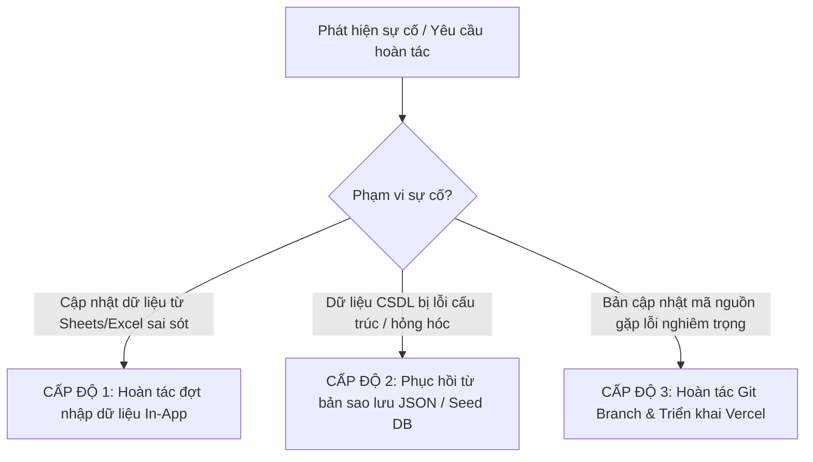

# QUY TRÌNH KHÔI PHỤC VÀ HOÀN TÁC (ROLLBACK PROCEDURES)
**Phân hệ:** Quản Lý Dân Cư Số Lương Hậu 2.3.0  
**Mục đích:** Hướng dẫn cán bộ quản trị và kỹ sư vận hành xử lý tình huống khẩn cấp, hoàn tác các đợt cập nhật dữ liệu sai sót hoặc hoàn tác toàn bộ mã nguồn về phiên bản ổn định trước đó mà không làm gián đoạn Cổng thông tin điện tử.

---

## 1. CÁC CẤP ĐỘ HOÀN TÁC (ROLLBACK LEVELS)



---

## 2. QUY TRÌNH CHI TIẾT THEO TỪNG CẤP ĐỘ

### 2.1. CẤP ĐỘ 1: HOÀN TÁC MỘT ĐỢT NHẬP DỮ LIỆU (BATCH ROLLBACK)
Áp dụng khi vừa thực hiện chức năng "Cập nhật từ Google Sheets" hoặc "Nhập tệp Excel", nhưng sau đó phát hiện dữ liệu nguồn bị sai lệch cột hoặc trùng lặp:

1. **Vào giao diện Quản lý:** Mở `admin.html` -> Chọn tab **"15. Nhật Ký Hoạt Động"** hoặc bảng thông tin đợt nhập tại tab **"6. Google Sheets"**.
2. **Xác định mã đợt nhập:** Tìm mã đợt nhập gần nhất (Ví dụ: `BATCH_20261024_001`).
3. **Nhấn nút Hoàn Tác:**
   - Nhấn nút **"Hoàn tác đợt này (Rollback)"**.
   - Hệ thống tự động truy xuất ảnh chụp dữ liệu (`chiTietBackup`) đã được lưu trữ trước khi ghi đợt nhập đó.
   - Xác nhận thông báo: *"Bạn có chắc chắn muốn hoàn tác toàn bộ các thay đổi của đợt nhập BATCH_xxx?"*.
4. **Kết quả:** Các bản ghi mới được gỡ bỏ, các bản ghi cũ được khôi phục về nguyên trạng trước khi nhập.

---

### 2.2. CẤP ĐỘ 2: PHỤC HỒI TOÀN BỘ CSDL VỀ TRẠNG THÁI HẠT NHÂN (FACTORY RESTORE)
Áp dụng khi dữ liệu trong trình duyệt của cán bộ bị xáo trộn hoặc cần nạp lại 466 hộ chuẩn:

1. **Cách 1: Sử dụng chức năng Phục hồi trong giao diện:**
   - Vào tab **"13. Sao Lưu & Phục Hồi"**.
   - Nếu có tệp sao lưu `.json` định kỳ: Nhấn **"Chọn tệp sao lưu"** -> Tải lên tệp sao lưu an toàn -> Nhấn **"Phục hồi dữ liệu"**.
   - Nếu muốn khôi phục về danh sách 466 hộ và 1.943 nhân khẩu chuẩn ban đầu: Nhấn nút **"Khôi phục CSDL hạt nhân (Seed DB)"**.
2. **Cách 2: Khôi phục bằng lệnh JavaScript tại Console (Dành cho Kỹ thuật viên):**
   ```javascript
   localStorage.removeItem('LUONG_HAU_DB_V2');
   window.location.reload();
   ```
   Hệ thống sẽ tự động kích hoạt nạp lại từ `assets/js/dan-cu-seed.js` với 466 hộ và 1.943 nhân khẩu hoàn chỉnh.

---

### 2.3. CẤP ĐỘ 3: HOÀN TÁC TOÀN BỘ MÃ NGUỒN TRÊN GIT VÀ VERCEL
Áp dụng khi cần gỡ bỏ hoàn toàn phân hệ mới và đưa mã nguồn trang web về trạng thái trước khi cài đặt:

1. **Hoàn tác nhánh Git trên máy cục bộ:**
   ```powershell
   # Chuyển về thư mục dự án
   cd C:\Users\Admin\.gemini\antigravity-ide\scratch\cong-ttdt-tdp-luong-hau

   # Kiểm tra trạng thái git
   git status

   # Quay lại nhánh chính ổn định
   git checkout main
   ```
2. **Hoàn tác trên Vercel Dashboard (Zero-Downtime Rollback):**
   - Truy cập Vercel Dashboard: `https://vercel.com` -> Chọn dự án `cong-ttdt-tdp-luong-hau`.
   - Vào mục **Deployments**.
   - Tìm bản triển khai trước thời điểm cập nhật (đang có nhãn trạng thái `Ready`).
   - Nhấp vào biểu tượng 3 chấm `...` -> Chọn **"Instant Rollback"** hoặc **"Promote to Production"**.
   - Trong vòng 5 giây, toàn bộ lưu lượng truy cập của website `https://luong-hau.vercel.app` sẽ trỏ lại phiên bản trước đó ngay lập tức.
